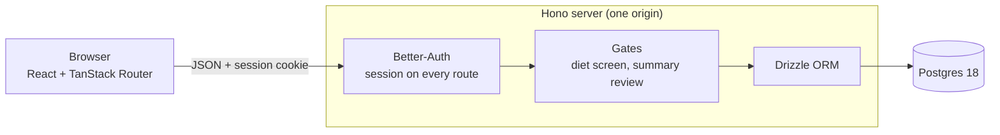
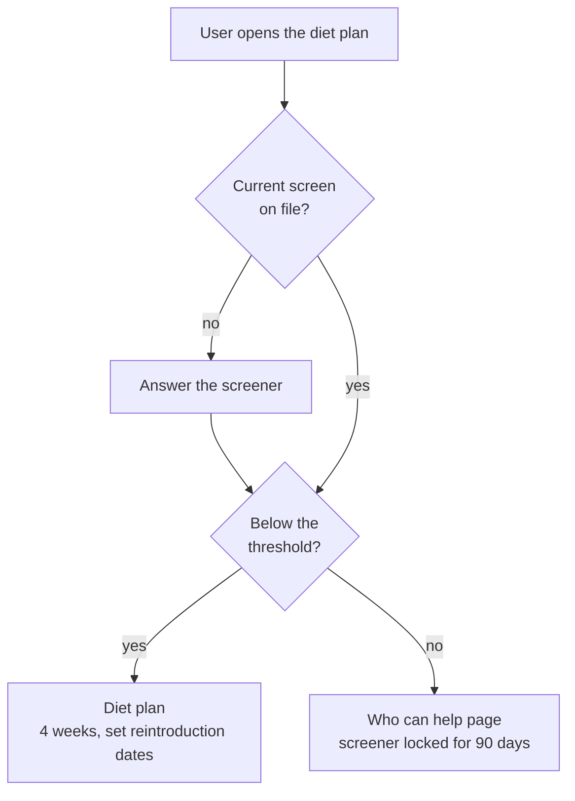

# Steady

[](https://github.com/biancacchino/steady-app/actions/workflows/ci.yml)

A food and symptom journal for people with IBS.
It checks for eating-disorder risk before showing any diet guidance, and it turns your journal into a short summary to bring to appointments.

## Why it exists

Elimination diets like low-FODMAP ask people to cut foods and track their bodies closely.
Those habits overlap with disordered eating, and clinical guidance says to screen for that risk first.
Appointments are also short, usually 10 to 15 minutes, which isn't enough to explain weeks of changing symptoms.

Steady handles both: a screener before any diet content, a journal that doesn't judge, and a summary you review before anyone else sees it.
The full requirements are in [`docs/prd.md`](docs/prd.md).

## What it does

- **Journal.** Log what you ate and any symptoms, one week at a time, with plain observations like "3 of 7 logged days mentioned bloating."
  Edit, delete with Undo, and flag entries worth raising at an appointment.
- **Appointment summary.** Pick a date range, go through your flagged entries, leave any out, and edit up to four questions.
  Export a PDF or copy the text, but only after you mark the summary reviewed.
- **Screener gate.** A short set of questions comes before any diet plan.
  The questions are placeholders for now and are labeled that way.
  Below the threshold, the plan opens with a 4-week end date and fixed reintroduction dates.
  At or above it, the plan stays hidden, a "who can help" page appears, and the screener locks for 90 days.
- **Account.** Save a care team email or link, download all your data as one JSON file, or delete the account and everything in it.
  The export leaves out your password, sign-in details, and screening score.
  Deleting needs your password and the typed phrase "delete my account".

Sign-up is invite only and requires confirming you are 18 or older.

## How it fits together

The browser only ever talks to one origin.
In development, Vite forwards `/api` to the Hono server; in production, the Hono server serves the built app itself.



The rules that matter live on the server, not in React, because anyone can call the API directly.
`/api/diet` answers 403 unless the user has a current screen below the threshold, and export refuses a summary that isn't marked reviewed.



The diet text never reaches the browser bundle.
`npm run check:bundle` fails the build if it does.

More detail, including the data model by milestone, is in [`design/steady-stack.html`](design/steady-stack.html).
The visual rules are in [`docs/design-brief.md`](docs/design-brief.md).

## Stack

| Part | Tools |
|---|---|
| Web | React 19, TanStack Router, React Aria Components, plain CSS with design tokens |
| Server | Node 24, Hono, Better-Auth, pdfkit for the summary PDF |
| Data | Postgres 18, Drizzle ORM with committed migrations |
| Tooling | npm workspaces, Turborepo, Biome, Vitest, Playwright |

There are no analytics and nothing loads from another origin.
The Content Security Policy allows no inline scripts or styles, and fonts are self-hosted.

## Repository layout

| Path | What's there |
|---|---|
| `apps/web` | The React app. Routes in `src/routes`, components in `src/components`, tokens in `src/styles/tokens.css` |
| `apps/server` | The Hono API, security headers, the summary PDF, and the screener rules |
| `packages/auth` | Better-Auth config: invite codes, 18+ confirmation, rate limits, account deletion |
| `packages/db` | Drizzle schema, migrations, and the local Postgres `docker-compose.yml` |
| `packages/env` | Validated server environment variables |
| `e2e` | Playwright tests |
| `scripts` | The tone check and the bundle check |
| `docs`, `design` | Requirements, design brief, and reference pages |

## Run it locally

You need Node 24 and a Docker engine (OrbStack or Docker Desktop).

```sh
npm install
cp apps/server/.env.example apps/server/.env   # then set BETTER_AUTH_SECRET (openssl rand -base64 32) and INVITE_CODE (openssl rand -hex 16)
npm run db:start                               # Postgres 18 in Docker, on port 5432
npm run db:migrate                             # apply migrations
npm run db:seed                                # create the demo account
npm run dev                                    # web on http://localhost:5173, API on :3000
```

Open http://localhost:5173, choose Sign in, and use the demo account: `user@example.com` / `Password123!`.
The seed script only runs against a database on this machine, so the demo account never reaches a real deployment.
To create a new account, you need the `INVITE_CODE` from `apps/server/.env`.

To reset the local database: `docker compose -f packages/db/docker-compose.yml down -v`, then `npm run db:start`, `npm run db:migrate`, and `npm run db:seed`.

## Checks

```sh
npm run ci
```

This runs everything CI runs, in order: format, lint, type check, tone check, unit tests, production build, bundle check, dependency audit, and the Playwright tests in Chrome, Firefox, Safari, and iPhone Safari.
Every Playwright test also fails if the page loads anything from another website or breaks the Content Security Policy.

Postgres has to be running with migrations applied, since some unit tests check the real tables.
The first time, install the browsers with `npx playwright install`.
The Playwright tests build and start their own server on port 3100 and never reuse one already there.
Set `E2E_PORT` to run them in a second worktree at the same time.

| Command | What it does |
|---|---|
| `npm run check:bundle` | Fails if any diet content is in the built web app (run after `npm run build`) |
| `npm run check:tone` | Fails on banned wording in user-facing text (PRD section 10) |
| `npm run db:generate` | Writes a migration after a schema change in `packages/db/src/schema` |
| `npm run db:studio` | Opens a browser view of the local database |
| `npm run db:seed` | Creates the demo account; safe to run again |

## Deploy

Steady runs on Render's free web service with Postgres 18 on Neon's free plan.
`render.yaml` is the Blueprint: it builds with `npm ci --include=dev && npm run build`, runs migrations, then starts the server.

1. Create a Neon project on Postgres 18 and copy its connection string (it ends in `?sslmode=require`).
2. In Render, choose New, then Blueprint, pick this repository, and use the same region as Neon.
3. Set `DATABASE_URL`, `INVITE_CODE` (`openssl rand -hex 16`), and `BETTER_AUTH_URL` (the `https://...onrender.com` address) in the dashboard.
   Render generates `BETTER_AUTH_SECRET`.

Don't use Render's free Postgres: it's deleted 44 days after it's created.
The free web service sleeps after 15 minutes without visitors, so the first visit after that takes about a minute.
More notes are in [`tasks/deploy.md`](tasks/deploy.md).

## How it was scaffolded

```sh
npx create-better-fullstack@latest steady --disable-analytics --frontend tanstack-router \
  --backend hono --runtime node --api none --database postgres --orm drizzle --db-setup docker \
  --auth better-auth --package-manager npm --ui-library react-aria --css-framework none \
  --testing vitest-playwright --validation zod --examples none
```

All other options were `none`.
The generated UI components, sample pages, and cookie settings were replaced; `CLAUDE.md` lists why.
